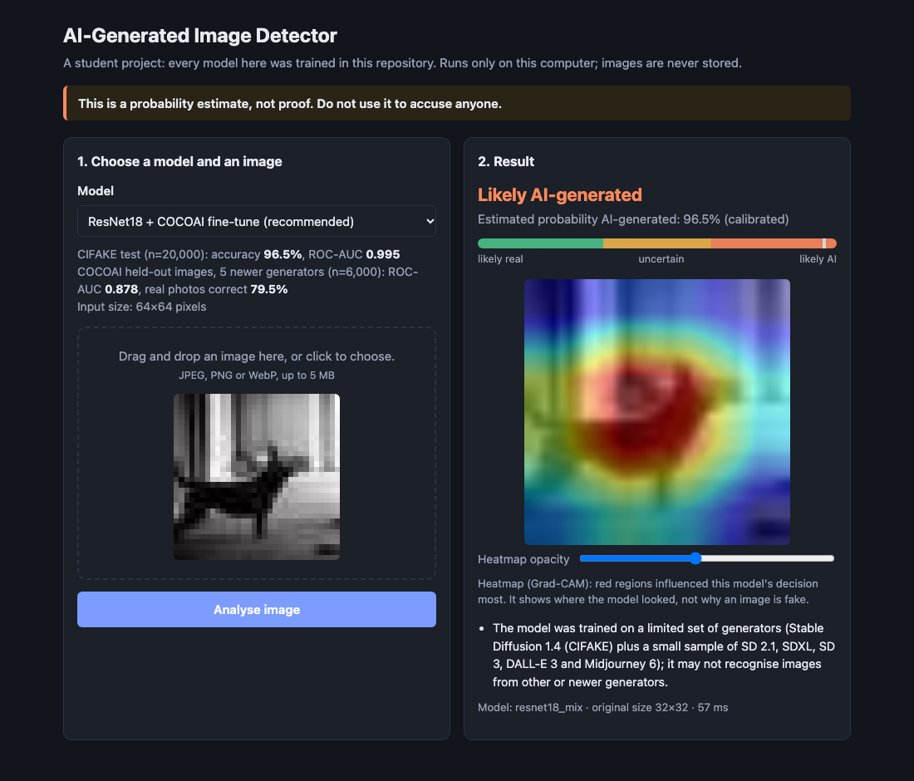

# AI-Generated Image Detector

An MCA project. It trains image classifiers **in this repository** to estimate whether an image is a real photo or AI-generated, explains each decision with a Grad-CAM heatmap, and serves them through a small web app on `127.0.0.1`.

- No external AI APIs are used: every prediction comes from a model trained here. Only the ResNet18 starting weights (ImageNet, from torchvision) are pretrained.
- Uploaded images are processed in memory and never stored.
- **The output is a probability estimate, not proof. Do not use it to accuse anyone.**



**Headline:** the models are very accurate on CIFAKE, the dataset they were trained on (up to 97.8% test accuracy). They are far weaker on images from newer generators and on resized or blurred images. A small fine-tune on COCOAI raises ResNet18's ROC-AUC on held-out COCOAI images from 0.61 to 0.88. Details: [reports/findings.md](reports/findings.md). Viva preparation: [docs/VIVA_NOTES.md](docs/VIVA_NOTES.md).

## What is in the repo

| Path | Purpose |
|---|---|
| `src/data.py` | CIFAKE listing, stratified train/val split, COCOAI subset loader, transforms |
| `src/models.py` | `SmallCNN` (from scratch) and `ResNet18Detector` (fine-tuned) |
| `src/train.py` | One training loop for every config: Adam, early stopping on val ROC-AUC, CSV log, curves |
| `src/evaluate.py` | Test metrics, confusion matrix, ROC curve, CPU latency, COCOAI per-generator evaluation |
| `src/calibrate.py` | Temperature scaling, ECE, reliability diagram |
| `src/robustness.py` | JPEG / resize / blur degradations |
| `src/gradcam.py` | Hand-written Grad-CAM with hooks |
| `src/infer.py` | Safe image loading, preprocessing, calibrated prediction, warnings |
| `app/` | FastAPI server + single-page UI |
| `scripts/` | Data inspection, COCOAI subset builder, Kaggle training script, report tables |
| `configs/` | One YAML per experiment |
| `reports/` | All metrics (JSON), logs and figures produced by real runs |
| `docs/VIVA_NOTES.md` | Plain-language explanations, maths, and likely viva questions |

## Setup (macOS, Python 3.11)

```bash
brew install python@3.11
cd ai-image-detector
python3.11 -m venv .venv
source .venv/bin/activate
pip install -r requirements.txt
pip install -e .          # makes `src` and `app` importable under `python -I`
```

`python -I` (isolated mode) is used for every command that reads downloaded data. It stops Python from importing files from the current folder, so a file planted in a dataset cannot run as code.

### Get the data

1. **CIFAKE (about 105 MB):** create a Kaggle token (kaggle.com, then profile picture, Settings, API, Create New Token), then run:
   ```bash
   mkdir -p ~/.kaggle && mv ~/Downloads/kaggle.json ~/.kaggle/ && chmod 600 ~/.kaggle/kaggle.json
   mkdir -p data/raw/cifake
   kaggle datasets download -d birdy654/cifake-real-and-ai-generated-synthetic-images -p data/raw/cifake --unzip
   python -I scripts/inspect_data.py --config configs/smallcnn.yaml
   ```
2. **COCOAI subset (about 1.5 GB of parquet files; the subset itself is much smaller):**
   ```bash
   mkdir -p data/raw/cocoai && cd data/raw/cocoai
   for f in validation-00000-of-00002 validation-00001-of-00002 train-00000-of-00007 train-00001-of-00007; do
     curl -L -o $f.parquet https://huggingface.co/datasets/Rajarshi-Roy-research/Defactify_Image_Dataset/resolve/main/data/$f.parquet
   done
   cd ../../..
   python -I scripts/prepare_cocoai.py --parquet-dir data/raw/cocoai --out data/cocoai
   ```

## Run the app

```bash
python -I -m app.main
# open http://127.0.0.1:8000
```

The app loads every model in `configs/app.yaml` whose checkpoint exists. The first one listed, ResNet18 + COCOAI fine-tune, is the default. The headline numbers in the UI are read from `reports/*.json`. Checkpoints are not committed (they are listed in `.gitignore`), so on a fresh clone you need to train first. Until then, the UI says that no models are available.

From the command line: `python -I -m src.infer --model resnet18_mix path/to/image.jpg`

A record of the end-to-end app test (real uploads and error cases) is in [reports/app_smoke_test.md](reports/app_smoke_test.md).

## Retrain everything

```bash
# Phase 2: baseline on CPU
python -I -m src.train    --config configs/smallcnn.yaml
python -I -m src.evaluate --checkpoint checkpoints/smallcnn.pt
# Phase 3: ResNet18 (Apple GPU: --device mps; NVIDIA: --device cuda; or CPU, slowly)
python -I -m src.train    --config configs/resnet18.yaml --device mps   # took 80 s/epoch on an M4 Pro
python -I -m src.evaluate --checkpoint checkpoints/resnet18.pt
# Phase 4: for each model: calibration, robustness, cross-generator test
python -I -m src.calibrate  --checkpoint checkpoints/smallcnn.pt
python -I -m src.robustness --checkpoint checkpoints/smallcnn.pt
python -I -m src.evaluate   --checkpoint checkpoints/smallcnn.pt --cocoai data/cocoai/manifest.csv
# Phase 4: fine-tune on CIFAKE + COCOAI, then evaluate the *_mix checkpoints
for m in smallcnn_mix resnet18_mix; do
  python -I -m src.train     --config configs/$m.yaml
  python -I -m src.evaluate  --checkpoint checkpoints/$m.pt
  python -I -m src.calibrate --checkpoint checkpoints/$m.pt
  python -I -m src.evaluate  --checkpoint checkpoints/$m.pt --cocoai data/cocoai/manifest.csv
done
python -I scripts/jpeg_quality_check.py     # shortcut check: JPEG quality per class
python -I scripts/gradcam_examples.py       # reports/figures/gradcam_examples.png
# Rebuild the results tables below from the JSON files
python -I scripts/report_tables.py
python -m pytest -q
```

### Training on Kaggle's free GPU

1. Zip the repo **without** `data/`, `.venv/` and `checkpoints/`:
   `zip -r code.zip . -x "data/*" ".venv/*" "checkpoints/*" ".git/*"`
2. On kaggle.com, go to Datasets, then New Dataset. Upload `code.zip`, name it `ai-image-detector-code` and keep it private.
3. Create a New Notebook. Under Settings, set Accelerator to **GPU T4 x2** (or P100). Then use **Add Input** to add `birdy654/cifake-real-and-ai-generated-synthetic-images` and your `ai-image-detector-code` dataset.
4. In a cell, run: `!python /kaggle/input/ai-image-detector-code/scripts/kaggle_train.py`
5. Download `kaggle_outputs.zip` from the notebook's Output panel and unzip it into the repo root. It contains `checkpoints/resnet18.pt` and the `reports/` files.

## Results

All numbers below are generated by `scripts/report_tables.py` from the JSON files in `reports/`. Interpretation is in [reports/findings.md](reports/findings.md).

<!-- RESULTS START -->
### CIFAKE test set (20,000 images, never used for training or tuning)

| Model | Input | Accuracy | F1 | ROC-AUC | Parameters | CPU ms/image | Trained on | Time/epoch x epochs |
|---|---|---|---|---|---|---|---|---|
| smallcnn | 32x32 | 0.9649 | 0.9651 | 0.9943 | 355,873 | 0.23 | cpu | 40 s x 15 |
| resnet18 | 64x64 | 0.9778 | 0.9779 | 0.9977 | 11,177,025 | 3.14 | mps | 80 s x 6 |
| smallcnn_mix | 32x32 | 0.9467 | 0.9472 | 0.9883 | 355,873 | 0.19 | cpu | 2 s x 10 |
| resnet18_mix | 64x64 | 0.9648 | 0.9643 | 0.9952 | 11,177,025 | 3.16 | mps | 3 s x 10 |

CPU ms/image: batch of 1 on this laptop's CPU, mean of 200 runs after warm-up.

### Calibration (T fitted on validation, reported on CIFAKE test)

| Model | Temperature T | ECE before | ECE after | NLL before | NLL after |
|---|---|---|---|---|---|
| smallcnn | 0.952 | 0.0049 | 0.0041 | 0.0956 | 0.0954 |
| resnet18 | 1.029 | 0.0028 | 0.0025 | 0.0600 | 0.0600 |
| smallcnn_mix | 0.620 | 0.0373 | 0.0086 | 0.1537 | 0.1403 |
| resnet18_mix | 1.501 | 0.0147 | 0.0033 | 0.1061 | 0.0960 |

### Robustness (CIFAKE test after degradation)

| Degradation | smallcnn acc | smallcnn AUC | resnet18 acc | resnet18 AUC |
|---|---|---|---|---|
| clean | 0.9649 | 0.9943 | 0.9778 | 0.9977 |
| jpeg_q90 | 0.9635 | 0.9938 | 0.9777 | 0.9976 |
| jpeg_q70 | 0.9576 | 0.9941 | 0.9750 | 0.9973 |
| jpeg_q50 | 0.9304 | 0.9882 | 0.9599 | 0.9933 |
| jpeg_q30 | 0.9125 | 0.9814 | 0.9190 | 0.9882 |
| resize_0.75 | 0.6487 | 0.8514 | 0.6453 | 0.9082 |
| resize_0.5 | 0.6870 | 0.8005 | 0.6263 | 0.7534 |
| blur_r0.5 | 0.8117 | 0.9757 | 0.8709 | 0.9909 |
| blur_r1.0 | 0.6563 | 0.8040 | 0.5931 | 0.7902 |

### Cross-generator generalisation (COCOAI held-out split: 1,000 real + 1,000 per generator)

| ROC-AUC unless stated | smallcnn | resnet18 | smallcnn_mix | resnet18_mix |
|---|---|---|---|---|
| CIFAKE test (in-distribution) | 0.9943 | 0.9977 | 0.9883 | 0.9952 |
| COCOAI overall | 0.5812 | 0.6096 | 0.7421 | 0.8780 |
| COCOAI real vs DALLE3 | 0.4325 | 0.5195 | 0.7313 | 0.9455 |
| COCOAI real vs Midjourney6 | 0.4289 | 0.4366 | 0.5788 | 0.8303 |
| COCOAI real vs SD2.1 | 0.8041 | 0.7528 | 0.8531 | 0.8725 |
| COCOAI real vs SD3 | 0.6351 | 0.7378 | 0.7707 | 0.8254 |
| COCOAI real vs SDXL | 0.6055 | 0.6011 | 0.7767 | 0.9161 |
| COCOAI accuracy (overall) | 0.4648 | 0.8133 | 0.6688 | 0.7897 |
| COCOAI real photos called real | 0.7290 | 0.0770 | 0.7230 | 0.7950 |

`_mix` = fine-tuned on CIFAKE + COCOAI fine-tuning split (different captions from the test split).
<!-- RESULTS END -->

## Limitations

- CIFAKE images are 32x32 pixels, and its fakes come from a single generator (Stable Diffusion 1.4). A model that is excellent on CIFAKE can still fail on modern generators and on full-size photos. See the cross-generator table and `reports/findings.md`.
- Large uploads are shrunk to 32x32 or 64x64 pixels and only the central square is analysed. Most of the fine detail is lost.
- Recompression (WhatsApp, Instagram), resizing and blur all reduce accuracy (see the robustness table).
- In COCOAI, every fake is square while real photos are not. Our centre-crop removes that shortcut. Other dataset biases may remain.
- Grad-CAM shows *where* the model looked, not *why* an image is fake. At 32x32 input the maps are coarse (8x8 for SmallCNN, 4x4 for ResNet18).
- Calibration was fitted on CIFAKE validation data. The probabilities are not guaranteed to be calibrated on other kinds of images.

## Ethics

Detectors like this make mistakes in both directions. A false "AI-generated" result can harm a real person's reputation, so the app shows a three-band verdict with a wide "uncertain" zone, states its limitations next to every result, and carries the disclaimer above. Uploaded images are never written to disk. The app binds only to `127.0.0.1`, so it cannot be reached from other machines.

## Citations

- J. J. Bird and A. Lotfi, "CIFAKE: Image Classification and Explainable Identification of AI-Generated Synthetic Images," *IEEE Access*, vol. 12, 2024. arXiv:2303.14126 (2023). Dataset: Kaggle `birdy654/cifake-real-and-ai-generated-synthetic-images` (MIT licence).
- A. Krizhevsky and G. Hinton, "Learning Multiple Layers of Features from Tiny Images," Technical report, University of Toronto, 2009 (CIFAR-10).
- R. Roy et al., "A Comprehensive Dataset for Human vs. AI Generated Image Detection," arXiv:2601.00553, 2026 (MS COCOAI / Defactify). Dataset: Hugging Face `Rajarshi-Roy-research/Defactify_Image_Dataset`. The dataset card states no licence and refers licensing questions to the authors, so it is used here for non-commercial academic evaluation only, and no images from it are committed.
- R. R. Selvaraju et al., "Grad-CAM: Visual Explanations from Deep Networks via Gradient-based Localization," ICCV 2017.
- C. Guo, G. Pleiss, Y. Sun and K. Q. Weinberger, "On Calibration of Modern Neural Networks," ICML 2017 (temperature scaling).
- K. He, X. Zhang, S. Ren and J. Sun, "Deep Residual Learning for Image Recognition," CVPR 2016 (ResNet).
